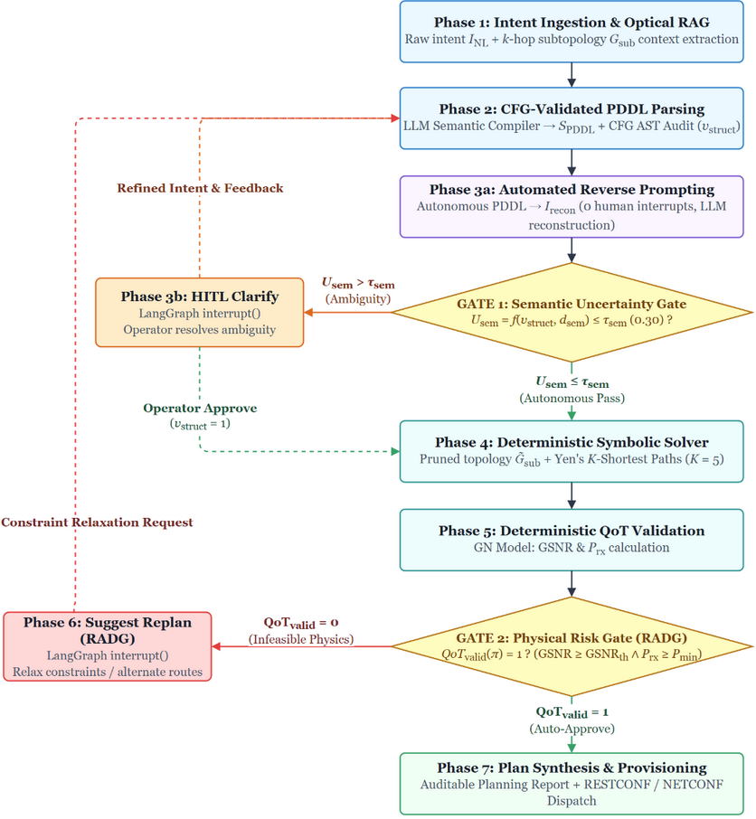
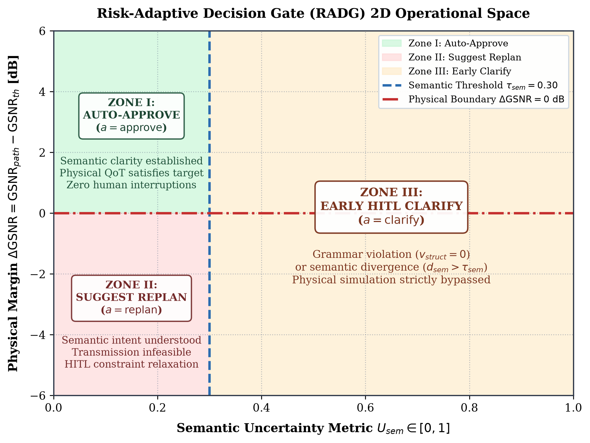
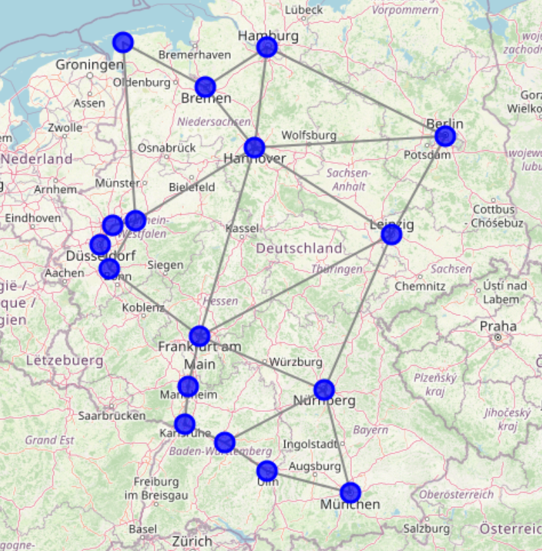
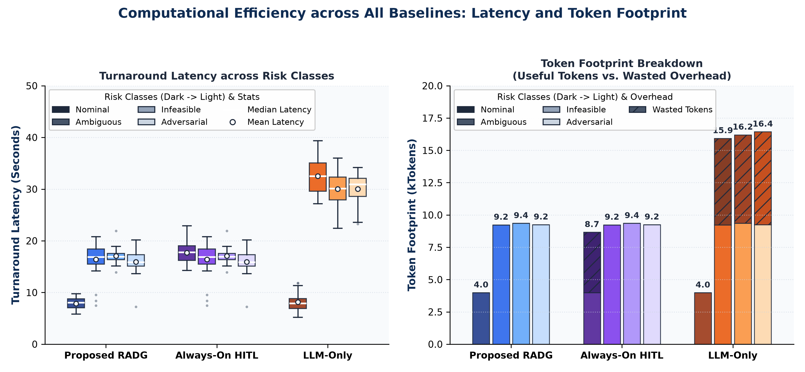
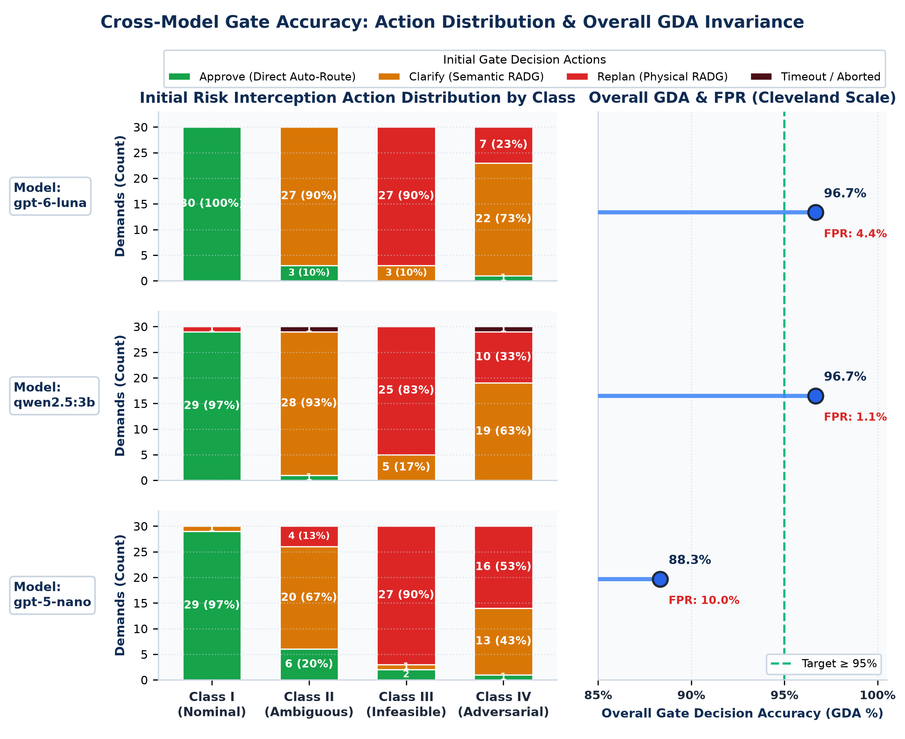

# MultiAgentON: LLM-Assisted Risk-Adaptive Neurosymbolic Intent Planning for Optical Networks

[](https://www.python.org/)
[](https://github.com/langchain-ai/langgraph)
[-brightgreen.svg)](#experimental-validation--the-four-core-pillars)
[-success.svg)](#experimental-validation--the-four-core-pillars)
[](#experimental-validation--the-four-core-pillars)
[](#network-environment--physical-parameters)
[](#academic-embargo--codebase-access)

> **Master's Thesis Research Project**  
> *Politecnico di Milano — Software-Defined Optical Networks (SDON) Research Laboratory*  
> **Topic:** A Pre-Deployment Decision Mechanism with Joint Semantic and Quality of Transmission (QoT) Assessment for Intent-Based Optical Networks (IBON).

---

> [!IMPORTANT]
> ## Academic Embargo & Codebase Access
> 
> This repository is the public project overview and architectural showcase for the Master's Thesis: **"LLM-Assisted Risk-Adaptive Neurosymbolic Intent Planning for Optical Networks: A Pre-Deployment Decision Mechanism with Joint Semantic and QoT Assessment"** developed at **Politecnico di Milano (DEIB)**.
> 
> **The production implementation codebase is currently hosted in a private repository under academic embargo** pending journal publication and thesis defense confidentiality agreements.
> 
> ### Requesting Full Codebase & Replication Package Access
> If you are an academic researcher, peer reviewer, or industry practitioner interested in inspecting the source code, replicating the benchmarks, or reviewing technical artifacts under NDA:
> 
> - **Author:** Felipe Abadía
> - **Email:** [felipeabadia01@gmail.com](mailto:felipeabadia01@gmail.com)
> - **Institution:** Politecnico di Milano — Dipartimento di Elettronica, Informazione e Bioingegneria (DEIB)
> - **GitHub Profile:** [@ABADIAb](https://github.com/ABADIAb)
> - **Location:** Milan, Italy

---

## Executive Summary

Translating high-level operator intents into physical optical network configurations using Large Language Models (LLMs) suffers from three fatal vulnerabilities:

1. **Physical Hallucinations:** LLMs cannot calculate nonlinear fiber impairments (e.g., Generalized Signal-to-Noise Ratio [GSNR], Non-Linear Interference [NLI], and Stimulated Raman Scattering). Allowing an LLM to heuristically assign optical lightpaths produces physically unfeasible deployments.
2. **Context Window Saturation:** Injecting raw optical network state (massive RESTConf JSON payloads) causes severe attention degradation (*"lost-in-the-middle"*), inflating inference costs and token latency.
3. **Suboptimal Human-in-the-Loop (HITL) Interventions:** Existing paradigms oscillate between *always-on HITL* (operator fatigue, operational bottlenecks) and *blind autonomous execution* (high risk of unfeasible physical deployments).

**MultiAgentON** introduces a **pre-deployment, fail-fast neurosymbolic pipeline** governed by **Risk-Adaptive Decision Gates (RADGs)**. Enforcing the strict principle **"LLMs reason, deterministic tools calculate"**, the system evaluates semantic uncertainty ($U_{sem}$) and physical feasibility ($QoT_{valid}$) sequentially *before* any configuration touches the optical network controller.

---

## Architecture Overview

The system decouples natural language reasoning from deterministic physical simulation through a 7-phase LangGraph pipeline:



### The 7-Phase Fail-Fast Pipeline

| Phase | Pipeline Stage | Description | Core Technology |
|---|---|---|---|
| **Phase 1** | **Intent Ingestion & Optical RAG** | Ingests natural language operator intent and dynamically extracts localized $k$-hop subtopologies via Mock GraphRAG to bound LLM context. | NetworkX, LangChain |
| **Phase 2** | **PDDL Translation & Grammar Check** | Translates natural language into formal Planning Domain Definition Language (PDDL) constraints, validated by a deterministic Context-Free Grammar (CFG) parser ($v_{struct} \in \{0, 1\}$). | Custom CFG AST Validator |
| **Phase 3** | **Semantic RADG ($U_{sem}$)** | Evaluates semantic uncertainty before any heavy routing or physics calculations. Automatically reconstructs intent via Reverse Prompting without human intervention unless uncertainty exceeds tolerance ($\tau_{sem}$). | Automated Reverse Prompting |
| **Phase 3b** | **HITL Clarification** | Interactive operator disambiguation via LangGraph `interrupt()`, triggered strictly when semantic ambiguity is detected. | LangGraph HITL State |
| **Phase 4** | **Symbolic Solver** | Computes 3–5 candidate lightpaths satisfying topological and path-exclusion constraints. | Yen's K-Shortest Paths (K-SP) |
| **Phase 5** | **QoT Physics Engine** | Evaluates candidate routes using a deterministic physical model, calculating exact GSNR accumulation and received optical power. | C-Band Coherent GN-Model |
| **Phase 6** | **Physical RADG** | Pre-deployment safety gate enforcing binary feasibility ($\text{GSNR} \ge \text{GSNR}_{threshold}$). Auto-approves feasible lightpaths or suggests constraint relaxation replanning. | Mathematical Decision Gate |
| **Phase 7** | **Plan Synthesis & Provisioning** | Generates auditable planning reports with full decision traces and provisions lightpaths via RESTConf testbed APIs. | RESTConf, Rich Report Generator |

---

## The Risk-Adaptive Decision Gates (RADGs)

The RADG mechanism formalizes pre-deployment safety as a piecewise decision function $D(U_{sem}, \text{QoT}_{valid})$ mapping to a ternary action space $\mathcal{A} = \{\text{approve}, \text{clarify}, \text{replan}\}$:



### 1. Semantic Uncertainty ($U_{sem}$)
Evaluated sequentially before physical path computation:
$$U_{sem} = \begin{cases} 1 & \text{if } v_{struct} = 0 \text{ (Grammar/AST Failure)} \\ d_{sem} & \text{if } v_{struct} = 1 \text{ (Semantic Divergence)} \end{cases}$$

Where $d_{sem} \in [0, 1]$ measures the semantic divergence between the original operator intent and the automated reverse-prompted reconstruction.

### 2. Physical Viability ($QoT_{valid}$)
Evaluated using the coherent Gaussian Noise (GN) physical model:
$$QoT_{valid} = \mathbb{I}(\text{GSNR}_{computed} \ge \text{GSNR}_{threshold} \land P_{rx} \ge P_{rx, min})$$

### 3. Pre-Deployment Decision Rule
$$D(U_{sem}, \text{QoT}_{valid}) = \begin{cases} \text{clarify} & \text{if } U_{sem} > \tau_{sem} \\ \text{replan} & \text{if } U_{sem} \le \tau_{sem} \land \text{QoT}_{valid} = 0 \\ \text{approve} & \text{if } U_{sem} \le \tau_{sem} \land \text{QoT}_{valid} = 1 \end{cases}$$

---

## Network Environment & Physical Parameters

Evaluations are conducted on the standardized **17-Node German Core Optical Backbone Network** (derived from the SNDlib repository, 26 bidirectional links, spans ranging from $37.5\text{ km}$ to $381.9\text{ km}$):



- **Fiber Specifications:** Standard ITU-T G.652 single-mode fiber (SMF-28) with attenuation coefficient $\alpha = 0.25\text{ dB/km}$, nonlinear Kerr coefficient $\gamma = 1.27\text{ W}^{-1}\text{km}^{-1}$, and dispersion $|\beta_2| = 21.7\times 10^{-27}\text{ s}^2/\text{m}$ ($D \approx 17.0\text{ ps/(nm}\cdot\text{km)}$ at $\lambda = 1550\text{ nm}$).
- **Amplification Chain:** Ingress pre-amplifiers, intermediate inline amplifiers (ILAs deployed approximately every $70\text{ km}$), and egress booster amplifiers. EDFA noise figures follow gain-dependent polynomial models (Attarpour et al., 2025) with transparent span loss compensation:
  - Boosters & ILAs: Gains in $[10, 23]\text{ dB}$, noise figures in $[6, 12]\text{ dB}$.
  - Pre-amplifiers: Gains in $[18, 32]\text{ dB}$, noise figures in $[6.2, 10.5]\text{ dB}$.
- **Spectrum & Transmission:** C-Band 96 WDM channels, $26\text{ dB}$ transponder back-to-back SNR floor, receiver sensitivity $P_{rx} \in [-18.0, -8.0]\text{ dBm}$, and bitrate feasibility thresholds ($8.6\text{ dB}$ for 100G QPSK, $15.2\text{ dB}$ for 200G 16-QAM, $21.5\text{ dB}$ for 400G).

---

## Experimental Validation & The Four Core Pillars

The architecture was evaluated against **three operational baselines** over a **120-demand benchmark corpus** partitioned symmetrically into four risk classes (30 demands each):
- **Class I (Nominal):** Fully specified, feasible requests.
- **Class II (Ambiguous):** Underspecified endpoints, missing bandwidth, or colloquial SLA terms ($U_{sem} > \tau_{sem}$).
- **Class III (Physically Infeasible):** Demands violating GN-model physical reach ($\text{GSNR} < \text{GSNR}_{th}$).
- **Class IV (Adversarial):** Conflicting topological constraints or malformed grammar ($v_{struct} = 0$).

### Comparative Performance (120 Demands)





The table below summarizes the empirical evaluation across the **Four Validation Pillars** comparing the Proposed RADG against Always-On HITL and LLM-Only across evaluated models (Qwen 2.5 3B local SLM, GPT-6 Luna frontier cloud, GPT-5 Nano fast cloud):

| Validation Pillar | Evaluated Metric | Proposed RADG (Qwen 2.5 3B) | Proposed RADG (GPT-6 Luna) | Proposed RADG (GPT-5 Nano) | Always-On HITL (GPT-6 Luna) | LLM-Only (GPT-6 Luna) |
|---|---|:---:|:---:|:---:|:---:|:---:|
| **Pillar 1: Semantic Translation** | Constraint Retention Rate ($\text{CRR}$) | 96.0% | **100.0%** | 93.2% | 100.0% | 100.0% |
| | CFG Grammar Pass ($\text{CFG-PR}$) | **95.8%** | 95.0% | 93.3% | 95.0% | 93.3% |
| | Semantic Agreement ($1 - d_{sem}$) | 0.858 | **0.955** | 0.963 | 0.462 | N/A |
| **Pillar 2: Physical Integrity** | False Positive Rate ($\text{FPR}$) | **1.1%** | 4.4% | 10.0% | 4.4% | 100.0% |
| | Physical Infeasibility Interception ($\text{PIIR}$) | 83.3% | **90.0%** | 90.0% | N/A | 0.0% |
| | Class III Pre-Deployment Interception | **100.0%** | **100.0%** | 90.0% | 100.0% | 0.0% |
| **Pillar 3: Efficiency & Friction** | Median Turnaround Latency $T_{E2E}$ | **13.19 s** | 15.89 s | 14.05 s | 16.84 s | 29.52 s |
| | Median Tokens per Demand | 9,118 | 9,200 | **8,702** | 9,200 | 15,908 |
| | Mean HITL Interventions ($\bar{N}_{hitl}$) | 0.73 | **0.72** | 0.68 | 0.97 | N/A |
| | Class I Nominal Autonomy | **100.0%** | **100.0%** | 96.7% | 0.0% | 100.0% |
| | Task Completion Rate ($\text{TCR}$) | 98.3% | **100.0%** | 100.0% | 100.0% | 100.0% |
| **Pillar 4: Gate Reliability** | Gate Decision Accuracy ($\text{GDA}$) | **96.7%** | **96.7%** | 88.3% | 96.7% | 25.0% |
| | Selective HITL Precision | 98.9% | **100.0%** | 98.8% | 74.1% | N/A |

### Key Empirical Findings

1. **Pre-Deployment Admission Failure Prevention:** Disabling decision gates (LLM-Only) forwards 100% of non-nominal demands directly to the controller, producing **90 simulated deployment incidents** and triggering reactive RESTCONF recovery loops that inflate token consumption by $68.8\%$ and double turnaround latency ($29.52\text{ s}$ vs. $15.89\text{ s}$). The Proposed RADG intercepts $90\%$ to $99\%$ of non-nominal traffic prior to controller admission.
2. **Mitigation of Operator Alert Fatigue:** The Always-On HITL baseline forces mandatory manual review on all 30 routine nominal requests, reducing Selective HITL Precision to $74.1\%$ (>1 in 4 interventions is a false alarm on well-formed traffic). The Proposed RADG delivers **100% nominal autonomy** on frontier and local SLM backends, saving 30 unnecessary human interruptions (**25.9% reduction in total operator interventions**) while keeping Selective HITL Precision at $98.8\% - 100\%$.
3. **Model-Agnostic Physical Integrity Floor:** For Class III physical reach violations, **100.0% of reach-violating lightpaths are intercepted pre-deployment** on GPT-6 Luna and Qwen 2.5 3B (with $83.3\% - 90.0\%$ intercepted directly by the Physical RADG and the remainder caught upstream by the Semantic RADG). Zero physical reach violations reach the optical controller.
4. **Local SLM Viability:** Running locally on commodity hardware (NVIDIA RTX 3050, 4 GB VRAM), `qwen2.5:3b` achieves **96.7% Gate Decision Accuracy** and an outstanding **1.1% False Positive Rate** due to conservative ambiguity interception, proving that carrier-grade pre-deployment safety does not mandate proprietary cloud models.

---

## Technology Stack

- **Pipeline Orchestration:** LangGraph (StateGraph, checkpointer persistence, `interrupt()` HITL primitives).
- **Language Models Supported:** Local Open-Weights (Ollama: `qwen2.5:3b`, `phi4-mini:latest`, `qwen3:4b`), OpenAI (`gpt-6-luna`), Moonshot / Kimi, OpenRouter.
- **Formal Verification:** Python Context-Free Grammar AST validator for PDDL subsets.
- **Routing & Physics:** Yen's K-Shortest Paths (NetworkX) + C-Band Coherent Gaussian Noise (GN) Model.
- **Software Engineering Standards:** Strict Test-Driven Development (TDD) with 364 automated tests, full Ruff compliance, and modular domain architecture.

---

## Academic Citation

If you reference this architecture or research methodology in your work, please cite:

```bibtex
@mastersthesis{abadia2026riskadaptive,
  author       = {Abadía, Felipe},
  title        = {LLM-Assisted Risk-Adaptive Neurosymbolic Intent Planning for Optical Networks: A Pre-Deployment Decision Mechanism with Joint Semantic and QoT Assessment},
  school       = {Politecnico di Milano},
  year         = {2026},
  address      = {Milan, Italy},
  department   = {Dipartimento di Elettronica, Informazione e Bioingegneria (DEIB)},
  note         = {Software-Defined Optical Networks (SDON) Research Laboratory}
}
```

---

## License

This project documentation and public assets are licensed under the [Apache 2.0 License](LICENSE).
